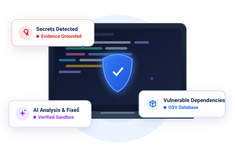
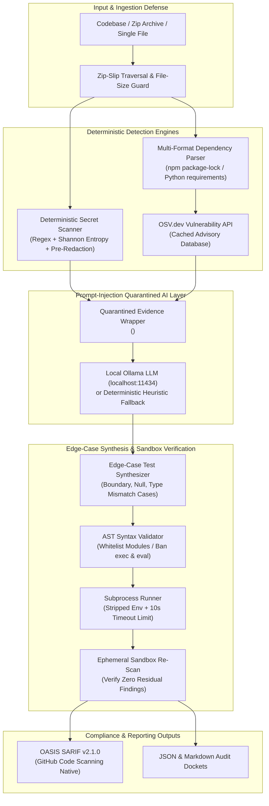

# RepoSentinel AI

<p align="center">
  <strong>Open-Source AI-Assisted Developer Security, Edge-Case Testing & Verified Remediation</strong><br>
  <em>Deterministic secret scanning, live OSV.dev dependency advisories, prompt-injection defense boundaries, AST-guarded test synthesis, and OASIS SARIF v2.1.0 exports.</em>
</p>

<p align="center">
  
</p>

<p align="center">
  
  
  
  
  
  
</p>

---

## Overview

**RepoSentinel AI** is an open-source, developer-first application security platform engineered to eliminate alert fatigue, stop speculative AI code hallucination, and automate verified vulnerability remediation. Built in Python with **Streamlit**, **OSV.dev REST APIs**, and **local Ollama open-weight LLMs**, the platform unifies deterministic secret scanning, live dependency CVE mapping, edge-case test generation, and sandbox-verified code patch application into a single, closed-loop developer workspace.

Unlike traditional AppSec scanners that dump un-prioritized lists of hundreds of dummy test secrets or suggest speculative fixes without testing them, RepoSentinel enforces a strict **Evidence-Backed Verification Loop**: every discovered vulnerability is mapped to empirical ground-truth advisories, patched via unified diff proposals, and automatically re-scanned in a sandbox environment to mathematically confirm the vulnerability is resolved before git commit.

---

## The AppSec Alert Fatigue Problem & The RepoSentinel Solution

### The Challenge
- **Alert Fatigue from Mock Secrets:** Naive secret scanners flag hundreds of dummy test fixtures, template variables, and placeholder strings (`${API_KEY}`, `<TOKEN>`), obscuring real leaked production credentials.
- **Disconnected CVE Lists:** Dependency checkers dump CVE identifiers without tracing the exact manifest version or offering verified patched version targets.
- **Hallucinated & Broken AI Fixes:** Generic AI code assistants propose speculative code edits without testing whether the patch introduces runtime syntax regressions or actually eliminates the security finding.
- **Data Leakage to Cloud LLMs:** Sending proprietary codebase snippets to third-party cloud AI APIs creates catastrophic IP leakage and compliance violations for enterprises.

### The RepoSentinel Solution
- **Entropy & Placeholder-Suppressed Secret Scanning:** High-precision regex rules combined with Shannon entropy thresholds and pre-redaction (`[REDACTED_...]`) filter out low-entropy mock strings and placeholders.
- **Direct OSV.dev Advisory Mapping:** Multi-format dependency extraction for npm (`package.json`, `package-lock.json` v1/v2/v3) and Python (`requirements.txt`, `pyproject.toml`, `Pipfile.lock`), queried live against the public **OSV.dev** vulnerability database with persistent caching.
- **AST-Guarded Subprocess Test Execution:** Synthesizes boundary test cases and inspects test code using Python's `ast` parser to reject forbidden modules (`os`, `sys`, `subprocess`, `socket`) before executing inside an isolated 10-second sandbox subprocess.
- **Sandbox-Verified Remediation:** Applies unified diff patches to an ephemeral sandbox copy and re-scans the file to empirically verify that the finding is resolved before any permanent change is committed.
- **100% Local Inference & Offline Fallback:** Native support for local open-weight models via **Ollama** (`qwen2.5-coder:7b`) with prompt-injection defense boundaries (`<UNTRUSTED_SCANNER_EVIDENCE>`). Seamlessly transitions to deterministic heuristic engines when offline.

---

## Architecture & Data Flow



---

## Core Implemented Capabilities

### 1. High-Precision Secret Scanning & Entropy Filtering
- Custom scanning engine detecting AWS Access Keys, GitHub Personal Access Tokens, Stripe API keys, Private RSA Keys, Slack Webhooks, and JWT tokens.
- Shannon entropy analysis suppressing repetitive strings, UUID placeholders, and template tokens (`${VAR}`).
- Automated token redaction ensuring secret values never leak into application logs, UI displays, or AI prompt contexts.

### 2. Multi-Ecosystem Dependency Advisory Mapping
- Native parsers for `package.json`, `package-lock.json` (versions 1, 2, and 3), `requirements.txt`, `pyproject.toml`, and `Pipfile.lock`.
- Direct integration with Google's public **OSV.dev** vulnerability database, mapping package versions against active CVE and GHSA advisories with local disk cache acceleration.

### 3. Prompt-Injection Resilient AI Triage
- Bounded input wrapping: user codebase evidence is isolated inside `<UNTRUSTED_SCANNER_EVIDENCE>` blocks to neutralize prompt injection attacks.
- Dual-mode operation: connects to local open-weight Ollama instances (`qwen2.5-coder:7b`) or operates entirely offline using deterministic rule-based heuristic triage.

### 4. AST-Guarded Test Synthesis & Sandbox Execution
- Automated generation of edge-case test suites (zero-division, null bytes, extreme bounds, unicode malformations).
- Static AST inspection scanning Python Abstract Syntax Trees to reject potentially malicious system calls (`os.system`, `subprocess.Popen`, `socket`, `eval`) before running tests in a restricted subprocess.

### 5. Verified Diff Patching & SARIF v2.1.0 Export
- Generates standard unified diff proposals substituting hardcoded credentials with safe environment variable retrievers (`os.environ.get()`, `process.env`).
- Re-scans temporary patched files to mathematically confirm finding remediation.
- Generates **OASIS SARIF v2.1.0** standard JSON logs for direct ingestion into GitHub Advanced Security Code Scanning tabs.

---

## Technology Stack

Verified directly from source code and package configurations:

| Component | Technology | Description |
|---|---|---|
| **Language & Runtime** | Python 3.11+ | Modern typed Python with dataclasses, asyncio, and AST inspection |
| **User Interface** | Streamlit 1.39+ | High-contrast multi-page AppSec workspace and dashboard |
| **Vulnerability Data** | OSV.dev REST API | Google Open Source Vulnerability database integration |
| **Local Inference** | Ollama REST Client | Local open-weight LLM inference (`qwen2.5-coder:7b`, `llama3.2`) |
| **Code Analysis** | Python `ast` module | Abstract Syntax Tree security whitelisting and dynamic parsing |
| **Compliance Export** | SARIF v2.1.0 Exporter | Standardized schema export for GitHub Code Scanning integration |
| **Testing & CI** | Pytest (50 Tests) | 100% passing test suite across detection, triage, and AST runners |

---

## Repository & Directory Structure

```text
reposentinel-ai/
├── assets/                     # Vector UI illustrations and custom AppSec icons
│   ├── hero_illustration.svg
│   ├── icon_ai.svg
│   ├── icon_findings.svg
│   ├── icon_lab.svg
│   └── icon_shield.svg
├── reposentinel/               # Core Application Package
│   ├── ai/                     # Local Ollama client & prompt injection delimiters
│   ├── analysis/               # AST validator & edge-case test synthesizer
│   ├── export/                 # SARIF v2.1.0, JSON, and Markdown report exporters
│   ├── remediation/            # Unified diff generator & sandbox re-scan verifier
│   ├── scanner/                # Entropy secret scanner & OSV.dev dependency parser
│   └── ui/                     # Streamlit views, layouts, and custom theme tokens
├── sample_project/             # Synthetic vulnerable test repository for immediate demo
├── tests/                      # 50 automated pytest suites verifying engine invariants
├── app.py                      # Primary Streamlit application entrypoint
├── requirements.txt            # Python dependencies
└── render.yaml                 # One-click cloud deployment manifest
```

---

## Quickstart & Local Execution

### 1. Prerequisites
- Python 3.11+
- Git
- Optional: [Ollama](https://ollama.com/) running locally with `ollama pull qwen2.5-coder:7b`

### 2. Clone and Setup Environment
```bash
git clone https://github.com/Swaraj0160/reposentinel-ai.git
cd reposentinel-ai

python -m venv venv
# Windows:
.\venv\Scripts\Activate.ps1
# Linux/macOS:
source venv/bin/activate

pip install -r requirements.txt
```

### 3. Run Automated Test Suite
Verify that all 50 engine invariants pass:
```bash
pytest tests/ -v
```

### 4. Launch Streamlit Dashboard
```bash
streamlit run app.py
```
Open `http://localhost:8501` to access RepoSentinel AI.

---

## Author & Acknowledgements

- **Lead Security Architect & Creator:** **Swaraj Ingale** ([@Swaraj0160](https://github.com/Swaraj0160))
- **Event:** Built for **Hacktoberfest 2026**
- **Standards:** Complies with OASIS SARIF v2.1.0 and NIST SP 800-218 Secure Software Development Framework (SSDF).
- **License:** Released under the [MIT License](LICENSE).
